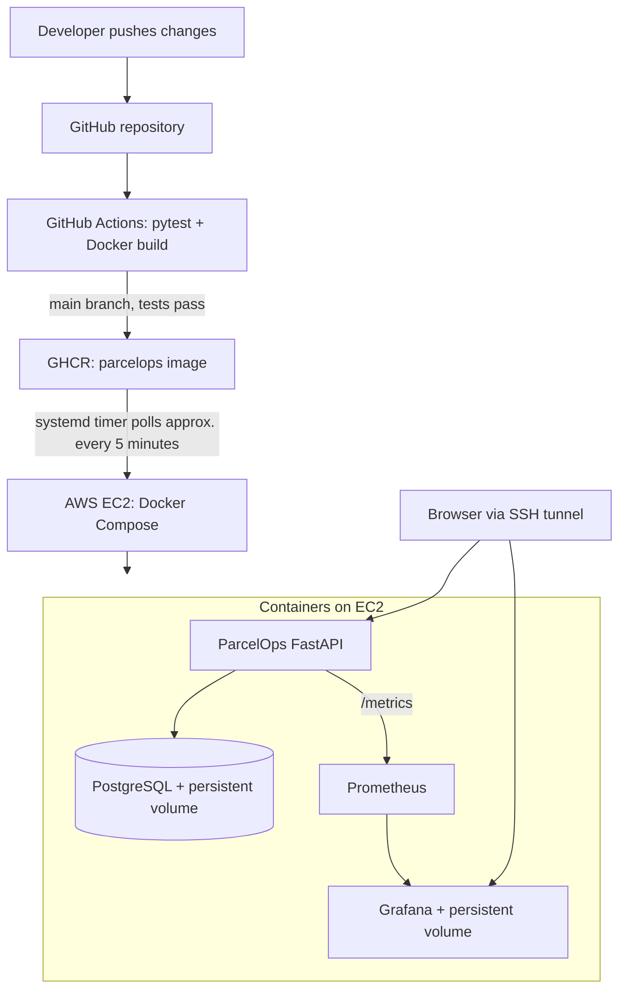

# ParcelOps

**Land parcel verification demo powered by a practical DevOps pipeline**

[](https://github.com/AbdulqudusO/parcelops/actions/workflows/ci.yml)

ParcelOps is a small, synthetic-data land parcel verification application built to connect **Land Administration** with **DevOps and cloud engineering**. The application deliberately stays simple: the core project is the automated process used to test, package, deploy, and monitor it.

**Repository:** https://github.com/AbdulqudusO/parcelops

## Land Administration problem and solution

In land administration, parcel records need a traceable verification status before further processing. ParcelOps demonstrates that workflow with three states: **Pending**, **Validated**, and **Disputed**. It is inspired by parcel validation and adjudication processes, but it is **not** a cadastral system or a replacement for a land registry.

The demo can:

- Register a synthetic parcel ID and locality.
- Display total parcels and counts by verification status.
- Update a parcel's status to Pending, Validated, or Disputed.
- Persist records in PostgreSQL across application container restarts.
- Expose health and metrics endpoints to support deployment checks and monitoring.

There is no parcel geometry, legal adjudication engine, user authentication, or real-world ownership data in this MVP.

## Technology stack

| Layer | Technology | Purpose |
| --- | --- | --- |
| Web application | Python 3.12, FastAPI, HTML/Jinja templates | Register and verify demonstration parcels |
| Data | PostgreSQL 16, SQLAlchemy | Persistent parcel records |
| Containerization | Docker, Docker Compose | Package and run services |
| Source control | Git, GitHub | Track and review changes |
| Continuous integration | GitHub Actions, pytest | Test and build on pushes and pull requests |
| Container registry | GitHub Container Registry (GHCR) | Publish versioned application images |
| Cloud hosting | AWS EC2 (Ubuntu) | Host the deployment |
| Continuous deployment | systemd timer + shell script on EC2 | Poll GHCR and update the app container |
| Metrics | Prometheus | Scrape and store application metrics |
| Dashboards | Grafana | Visualize availability, traffic, latency, memory |

## Architecture



**Key design decision:** CI/CD is *pull-based*. GitHub Actions publishes the Docker image, and an EC2-hosted systemd timer periodically checks for new images. No inbound SSH access from GitHub-hosted runners is required. The deployment procedure updates only the application container; the database and monitoring volumes remain in place.

## Run locally with Docker

Prerequisites: Docker Engine or Docker Desktop with Docker Compose, Git, and a Linux/WSL terminal.

```bash
git clone https://github.com/AbdulqudusO/parcelops.git
cd parcelops
cp .env.example .env
docker compose up --build -d
docker compose ps
```

Open **http://localhost:8000**. Register a *synthetic* parcel, for example `PAR-001` in `Agbarho`, and update its status to `Validated`.

Check health and metrics:

```bash
curl -fsS http://localhost:8000/health
curl -s http://localhost:8000/metrics | grep parcelops_http_requests_total | head
```

The health endpoint returns `{"status":"ok","database":"connected"}` when the application and database are available.

View logs:

```bash
docker compose logs --tail=30 app
```

To stop containers without deleting the PostgreSQL volume:

```bash
docker compose down
```

**Never run `docker compose down -v` unless you deliberately want to delete the demo data volumes.**

## Automated testing and CI

Run tests locally without Docker:

```bash
python3 -m venv .venv
source .venv/bin/activate
pip install -r requirements.txt
pytest -q
```

The automated tests use an in-memory SQLite database; the deployed application uses PostgreSQL.

The `.github/workflows/ci.yml` workflow performs the following steps:

1. On a push or pull request, install Python dependencies, run pytest, and build the Docker image.
2. On a successful push to `main`, build and publish the image to GHCR.
3. Publish both `latest` and a Git commit SHA tag for traceability.

**Published image:** `ghcr.io/abdulquduso/parcelops:latest` (container names are lowercase).

The GitHub Actions jobs and GHCR publication have been verified in the project demonstration.

## Monitoring with Prometheus and Grafana

For a local monitoring stack, add a unique Grafana password to your local `.env` file (do not commit it):

```bash
printf '\nGRAFANA_ADMIN_PASSWORD=%s\n' "$(openssl rand -hex 16)" >> .env
chmod 600 .env

docker compose -f compose.yaml -f compose.monitoring.yaml up -d --build
```

The monitoring setup consists of:

- `monitoring/prometheus.yml`: scrapes `app:8000/metrics` every 15 seconds.
- `compose.monitoring.yaml`: runs Prometheus and Grafana, publishing their ports on the **host loopback** interface only.
- `dashboards/parcelops-dashboard.json`: exported Grafana dashboard configuration; import it through Grafana's dashboard UI to recreate the panels. It is **not auto-provisioned**.

The four dashboard panels are:

| Panel | PromQL query |
| --- | --- |
| Application availability | `up{job="parcelops"}` |
| HTTP requests in a rolling 5-minute window | `sum(increase(parcelops_http_requests_total[5m]))` |
| Mean HTTP response time in milliseconds | `1000 * sum(rate(parcelops_http_request_duration_seconds_sum[5m])) / clamp_min(sum(rate(parcelops_http_request_duration_seconds_count[5m])), 0.000001)` |
| FastAPI process resident memory | `process_resident_memory_bytes{job="parcelops"}` |

With the monitoring Compose file running **locally**, visit Grafana at `http://localhost:3000` and Prometheus at `http://localhost:9090`. Configure the Grafana Prometheus data source as `http://prometheus:9090` (the Docker network service name).

## AWS EC2 deployment

The demonstrated deployment runs on an Ubuntu EC2 instance with Docker Compose. Configure your own EC2 instance and SSH access; **never commit or share private SSH keys or `.env` files**. Set strong, unique database and Grafana passwords before running the cloud stack.

On EC2, with the repository checked out and `.env` configured:

```bash
cd ~/parcelops
sudo docker compose -f compose.yaml -f compose.monitoring.yaml up -d --build
sudo docker compose -f compose.yaml -f compose.monitoring.yaml ps
curl -fsS http://127.0.0.1:8000/health
```

To switch only the application to the published GHCR image:

```bash
sudo docker pull ghcr.io/abdulquduso/parcelops:latest
sudo docker compose \
  -f compose.yaml -f compose.monitoring.yaml -f compose.deploy.yaml \
  up -d --no-deps --no-build app
```

`compose.deploy.yaml` overrides the application image while leaving PostgreSQL and monitoring service definitions intact. The PostgreSQL and Grafana data volumes are persistent.

### Secure browser access via SSH tunneling

The classroom environment uses SSH tunnels rather than exposing monitoring ports publicly. From your **local** terminal, using your own private key and the instance's *current* public IP:

```bash
ssh -i ~/.ssh/parcelops-key.pem -N \
  -L 18002:127.0.0.1:8000 \
  -L 13000:127.0.0.1:3000 \
  -L 19090:127.0.0.1:9090 \
  ubuntu@YOUR_EC2_PUBLIC_IP
```

Keep the tunnel terminal open. In the browser, use:

- ParcelOps: `http://localhost:18002`
- Grafana: `http://localhost:13000`
- Prometheus: `http://localhost:19090`

Grafana's data source still points to `http://prometheus:9090` inside the Docker network, **not** to the SSH tunnel address.

**Security note:** The base Compose file binds the application to all EC2 host interfaces (`8000:8000`). Keep its AWS security-group rule restricted or closed; do not expose this unauthenticated HTTP demo publicly. PostgreSQL port 5432 should never be internet-accessible.

## Automated deployment on EC2

The actual classroom EC2 host has a separate deployment script at `/home/ubuntu/parcelops-deploy.sh` and these systemd units:

- `/etc/systemd/system/parcelops-deploy.service`
- `/etc/systemd/system/parcelops-deploy.timer`

**These EC2-hosted files are not currently included in this repository.** The timer is configured to check GHCR approximately every five minutes. Its script compares the running app image ID with `latest`, pulls a newer image, recreates **only** the app container, and verifies `/health`. A mechanism for blocking previously failed images and attempting rollback exists, but **rollback under failure has not yet been tested**.

Inspect the timer and deployment logs **on EC2**, not in local WSL:

```bash
sudo systemctl status parcelops-deploy.timer --no-pager
systemctl list-timers --all | grep parcelops
sudo journalctl -u parcelops-deploy.service -n 50 --no-pager
```

**Verified end-to-end demonstration:** after a visible HTML change was pushed to GitHub, GitHub Actions published an updated image. An unattended timer execution on EC2 downloaded and deployed it, passed its health check, and the updated text appeared in the browser. The existing parcel record remained available. This validates the normal successful deployment path, not failure rollback.

## Repository structure

```text
app/                           FastAPI code, templates and static files
tests/                         Automated tests
.github/workflows/ci.yml       Test, build and publish pipeline
Dockerfile                     Application image definition
compose.yaml                   ParcelOps and PostgreSQL
compose.monitoring.yaml        Prometheus and Grafana
compose.deploy.yaml            GHCR application image override
monitoring/prometheus.yml      Prometheus scrape configuration
dashboards/parcelops-dashboard.json  Exported Grafana dashboard
.env.example                   Demonstration environment template
README.md                      Project setup and architecture
```

## Limitations and next improvements

This is an educational MVP, **not a production-ready land registry**. It uses synthetic parcels only and lacks authentication, authorization, cadastral boundaries, dispute evidence, formal adjudication, TLS, and production-grade recovery procedures.

Potential improvements include testing rollback in a controlled environment; committing and hardening the deployment script and systemd units; using immutable image digests for deployment approvals; pinning container image versions; using HTTPS and authentication; and integrating GIS parcel geometry only if the project scope expands.

**Kubernetes is not part of the implemented architecture.** Docker Compose on EC2 was chosen to keep the final project achievable and to prioritize CI/CD and observability.

## Cloud cost and cleanup

An EC2 instance, EBS volume, and public IPv4 address can incur charges. Stop or terminate classroom resources when no longer needed, according to the AWS account owner's policies. Stopping EC2 does not necessarily remove EBS or other charges. Before terminating, export any needed demonstration evidence and preserve the dashboard JSON.

---

*ParcelOps demonstrates a practical connection between land administration workflows and modern software delivery: small application, reproducible containers, automated verification and delivery, and live operational monitoring.*
